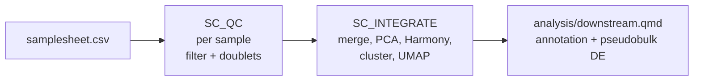

# scrna-nf-seurat

A small, reproducible single-cell RNA-seq workflow: **Nextflow** orchestrates per-sample QC and integration in **R** (Seurat, scDblFinder, Harmony), followed by a Quarto report with cell type annotation and pseudobulk differential expression.



## Status

| Part | State |
|---|---|
| Pipeline wiring, config, profiles | Written; stub run covered by CI |
| R scripts (`bin/`) | Written, not yet run on real data |
| Container (`Dockerfile`) | Written, not yet built |
| Downstream report | Skeleton |

Update this table as each piece is validated.

## Input

A CSV with one row per 10x sample. `matrix_dir` points to a Cell Ranger `filtered_feature_bc_matrix` directory and is resolved relative to the samplesheet.

```csv
sample,condition,donor,matrix_dir
d1_ctrl,ctrl,d1,d1_ctrl
d1_stim,stim,d1,d1_stim
```

## Example dataset (verify before use)

Planned: GEO [GSE166992](https://www.ncbi.nlm.nih.gov/geo/query/acc.cgi?acc=GSE166992), PBMCs from COVID-19 patients and healthy controls (10x 5'). The sample labels in `assets/GSE166992_samplesheet.csv` (GSM5090446-GSM5090454; healthy: IVAR2, IVAR4, IVAR10; COVID-19: IVAR3, IVAR5-IVAR9) were checked against the GEO sample pages by the project author. One donor per sample is an assumption to confirm.

Things to check before trusting it:

- **Species.** GEO's processing notes mention both an `mm10` transcriptome and an `Hg37` genome build. Inspect the feature names (the organizer script prints the first few). The QC script also stops if no genes match the mito pattern.
- **IVAR8** is listed without per-sample supplementary files. It may still be inside `GSE166992_RAW.tar`; the organizer warns about any sample with fewer than 3 files.
- **Cell counts** are not reported by GEO; the organizer prints them from the barcode files.

```bash
wget -O GSE166992_RAW.tar https://ftp.ncbi.nlm.nih.gov/geo/series/GSE166nnn/GSE166992/suppl/GSE166992_RAW.tar
mkdir raw_geo && tar -xf GSE166992_RAW.tar -C raw_geo
bin/organize_geo_10x.sh raw_geo data
cp assets/GSE166992_samplesheet.csv data/samplesheet.csv
nextflow run . -profile docker --input data/samplesheet.csv
```

Each donor contributes one sample, so Harmony is off by default and the pseudobulk design is `~ condition`.

## Quick start

```bash
# 1. Check the wiring without containers or data (what CI runs)
nextflow run . -profile test -stub-run

# 2. Real run, locally with Docker
nextflow run . -profile docker --input my_samplesheet.csv --outdir results

# 3. On a Slurm cluster with Apptainer/Singularity
nextflow run . -profile slurm,singularity --input my_samplesheet.csv

# 4. Resume after a failure or an edit
nextflow run . -profile docker --input my_samplesheet.csv -resume

# Tests
nf-test test
```

Build the container first (see `Dockerfile`) and set `process.container` in `nextflow.config`.

## Design decisions

- **Doublets are removed per sample, after basic QC.** scDblFinder assumes a reasonable cell population, so low-quality cells are filtered first.
- **Harmony is optional and guarded.** It should only correct a technical batch (sequencing run, chemistry), never the condition under test. With one sample per donor and donors split across conditions, `donor` is nested in `condition`, so correcting for it would erase the signal. The script stops with an error in that case; use `--batch_var none` instead.
- **Pseudobulk for differential expression.** Cells from the same donor are not independent replicates; aggregating per sample and cell type avoids inflated significance.
- **Stub blocks in every process.** CI verifies channels, config and process wiring in seconds without containers or data.
- **Retries with growing memory.** Resource requests scale with `task.attempt`, and retryable exit codes (including out-of-memory and interruptions) trigger a retry. This pairs well with `-resume` and Spot instances.

## Running on AWS Batch (design, not yet run)

The `awsbatch` profile is configured for an S3 work directory and a Batch queue:

```bash
nextflow run . -profile awsbatch,docker \
    --aws_queue my-spot-queue --input s3://bucket/samplesheet.csv \
    -work-dir s3://bucket/work
```

Intended setup: inputs and outputs in S3 (lifecycle rules move raw data to cheaper tiers), a Batch compute environment on Spot for the interruptible QC tasks, and an IAM role limited to the one bucket. This profile has not been exercised against a live AWS account.

## Known limitations and roadmap

- [ ] Run on a real public dataset and record the results here
- [ ] Ambient RNA correction (SoupX or decontX) before doublet detection
- [ ] Samplesheet validation with nf-schema
- [ ] Per-process nf-test tests with tiny real data
- [ ] Publish container via GitHub Actions
- [ ] Pin analysis packages with `renv`

## License

MIT (add a `LICENSE` file with your name).
